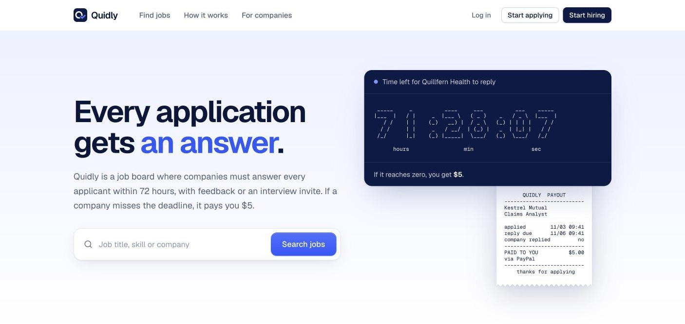
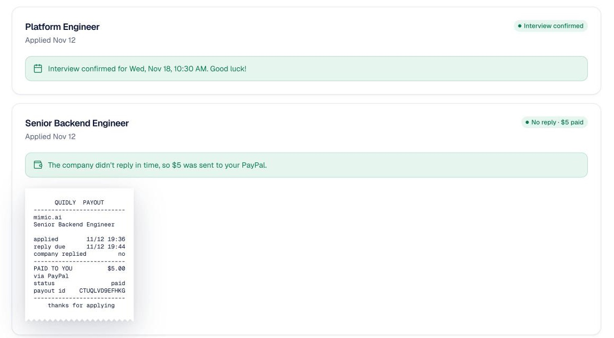
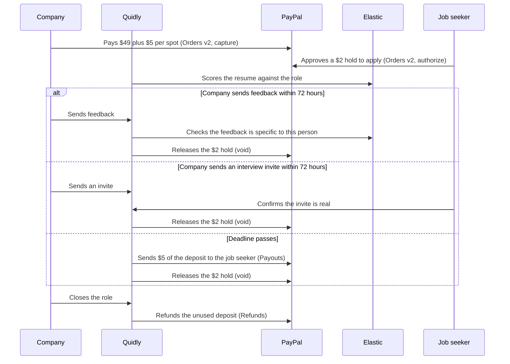

# Quidly

**A job board where every application gets an answer, or $5.**

Companies on Quidly put down a refundable $5 deposit for every applicant. They have 72 hours to reply to each one with real feedback or an interview invite. If they stay silent, PayPal sends that $5 to the person they ignored.

**Live site:** https://quidly-theta.vercel.app

**Demo video (2:44):** https://youtu.be/hpFs0qBbj3E

PayPal runs in sandbox mode, so no real money moves. Judges: the sandbox logins are in the Devpost testing instructions.



## Why

Applying for a job takes hours. Ignoring an applicant costs a company nothing, so most applications never get a reply. Quidly puts a small, fixed price on silence and pays it to the job seeker who was left waiting. Companies that reply to everyone get their whole deposit back, so for them the only cost is the $49 listing fee.

## How it works

**Job seekers**
1. Log in with PayPal and upload a resume PDF.
2. Apply with a $2 PayPal hold. It's never charged, and you can have 5 applications open at once.
3. Get an answer within 72 hours, or get $5.

**Companies**
1. Set up a company profile. Quidly checks it before you can post.
2. Post a role and pay through PayPal: $49, plus a $5 deposit for each applicant spot.
3. Reply to applicants from the reply queue. When you close the role, the unused deposit comes back.

| What happens | The job seeker's $2 hold | The company's $5 |
|---|---|---|
| Feedback that passes the AI checks | Released | Kept for the refund |
| Interview invite, confirmed by the job seeker | Released | Kept for the refund |
| Invite reported as not genuine | Stays on hold | Stays locked |
| No reply in 72 hours | Released | Paid to the job seeker |



## Try it in 2 minutes

1. **Post a role:** on the live site, press "Start hiring" and log in with a company sandbox account. Fill in the company profile, post a role and pay in the PayPal window.
2. **Apply:** in a private window, press "Start applying" and log in with a job seeker account. Upload a resume PDF and apply. Approve the $2 hold. There are 2 sample resumes in [`assets/sample-resumes`](assets/sample-resumes): a backend engineer who matches the default role well, and a data engineer who doesn't.
3. **Try a lazy rejection:** as the company, open the reply queue and send "Sorry, we went with someone else." The AI check blocks it.
4. **Let a deadline run out:** press "Skip to 45s" on an applicant and wait. The row turns red, PayPal pays the job seeker $5, and a receipt appears on their dashboard.
5. **Close the role:** the unused deposit is refunded to the company.

## How the money moves



## What's inside

### PayPal: 5 parts of the platform

| Part | What Quidly uses it for |
|---|---|
| Log In with PayPal | Every account is a PayPal identity, which makes fake sign-ups harder. |
| Orders v2, capture | The company pays the listing fee and the whole deposit in one payment. |
| Orders v2, authorize and void | The job seeker's $2 hold, released as soon as the company answers. |
| Payouts | Sends $5 to a job seeker whose deadline ran out. |
| Refunds | Returns the unused deposit when a role closes. |

### AI: Elastic

Every embedding comes from Elastic's hosted inference endpoint (`.openai-text-embedding-3-small`).

**Feedback checks.** A rejection must pass 3 checks, in this order:
1. **Not a template.** Known form rejections are indexed in Elastic as `semantic_text`. A reply scoring 0.73 or higher against any of them is blocked.
2. **Real sentences.** At least 12 words, with enough small joining words that it reads as sentences, not a keyword list.
3. **About this person.** The feedback is compared with this resume and this role. Below 0.40, it's blocked as off-topic.

**Match score.** When someone applies, their resume is scored against the role. The reply queue shows it as Strong, Good, Partial or Weak, with bands set from real scores (a strong backend resume scored 0.63 against a backend role, an unrelated one 0.25).

### AG Grid: the reply queue

The company's reply queue is built on AG Grid Community 36.
- **Sorting:** most urgent first, by time left and then by match score, with multi-column sorting.
- **Countdowns:** every row counts down each second.
- **Row colors:** rows turn amber as a deadline gets close and red when it's due or missed.
- **Status changes:** cells flash when an applicant's status changes.
- **Deposit at risk:** a live counter of the deposit on unanswered applicants, with the time until the next $5 payout.
- **Custom cells:** custom renderers for the applicant, match, status and time-left columns.

### Built to handle money safely

- **Outcome first:** when a deadline passes, the outcome is saved before any money moves. The update only claims applications still waiting, so a reply and a payout can never both win.
- **No double payouts:** each payout uses a fixed batch ID per application, so a retry can't pay twice.
- **Safe retries:** releasing a hold that PayPal already released counts as done.
- **Deadline checker:** runs every 2 seconds. It releases holds, sends queued payouts and checks pending payouts with PayPal. If a PayPal call fails, it tries again on the next run.
- **Tests:** 77 tests run on Vitest with PGlite, covering the money flows, the feedback checks and the routes.

## Repo layout

| Folder | What's in it |
|---|---|
| `web/` | Next.js website, deployed on Vercel |
| `api/` | Fastify API in TypeScript, with Postgres and Drizzle, deployed on Render. It also runs the deadline checker. |

## Run it locally

You need Node 26, a Postgres database, PayPal sandbox app keys and an Elastic Cloud deployment.

```sh
# API
cd api
cp .env.example .env   # fill in the values
npm install
npm run dev            # runs migrations, adds the sample companies, starts the deadline checker
npm test

# Website
cd web
npm install
API_URL=http://localhost:4000 npm run dev
```

Log In with PayPal returns to the URL set in your PayPal app, so logging in locally needs that URL to point at your machine.

### Demo mode

With `DEMO_MODE_ENABLED=true`, a job seeker can apply with a 90-second reply window instead of 72 hours. A company can also move any waiting application to its last 45 seconds with "Skip to 45s" in the reply queue. That shows the $5 payout without waiting 3 days.

## Built with

PayPal, Elastic, AG Grid, Next.js, React, TypeScript, Fastify, PostgreSQL, Drizzle, Render and Vercel. Built for the PayPal AI Hackathon.

## License

MIT
